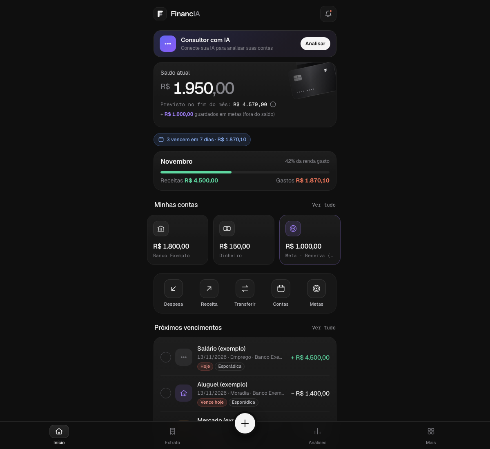
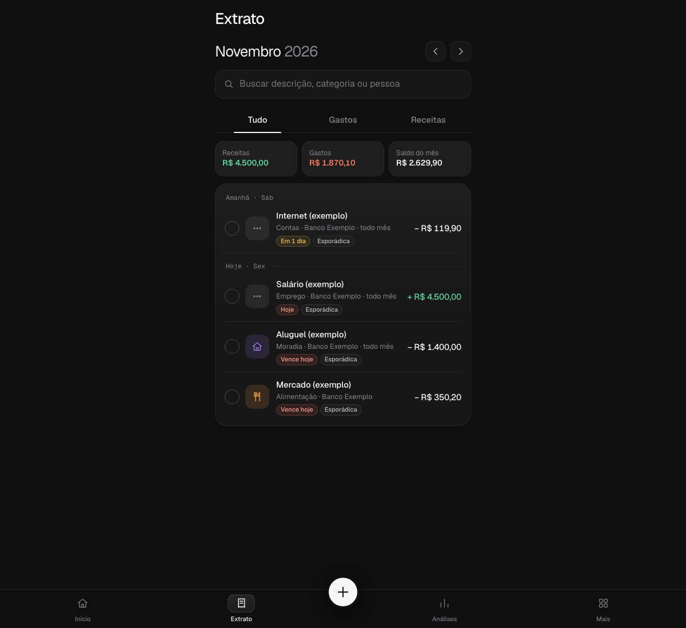
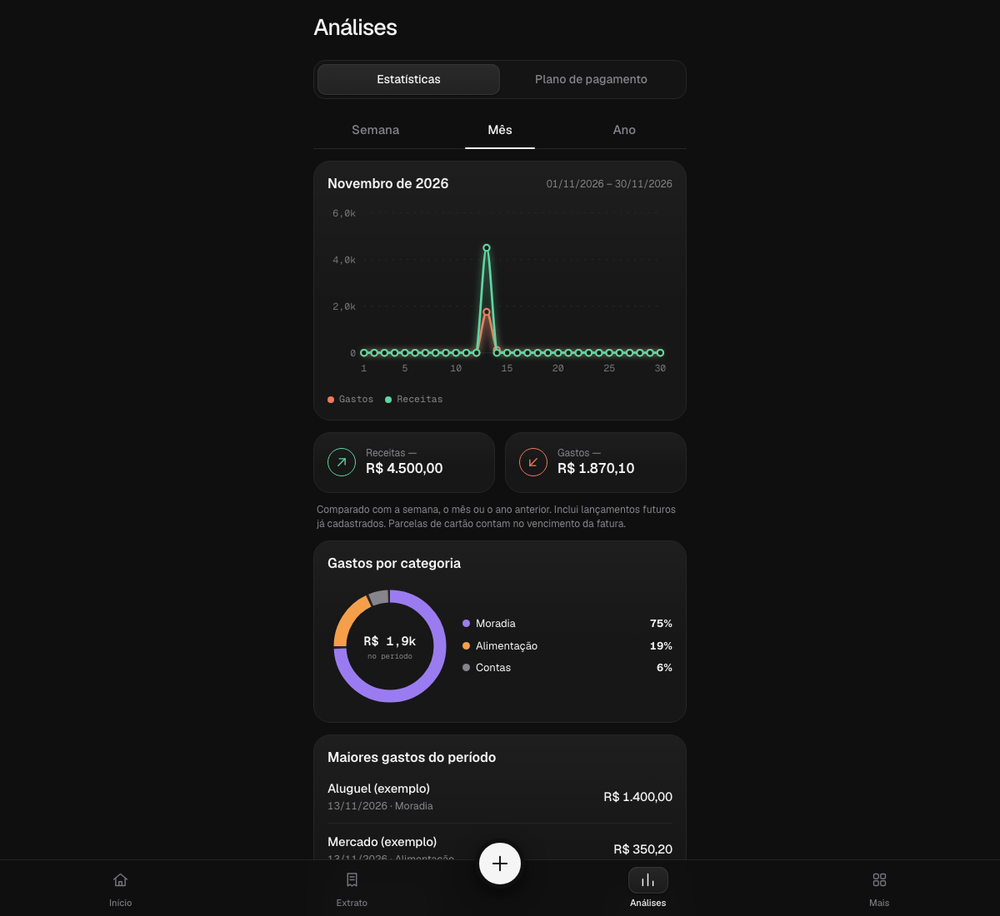
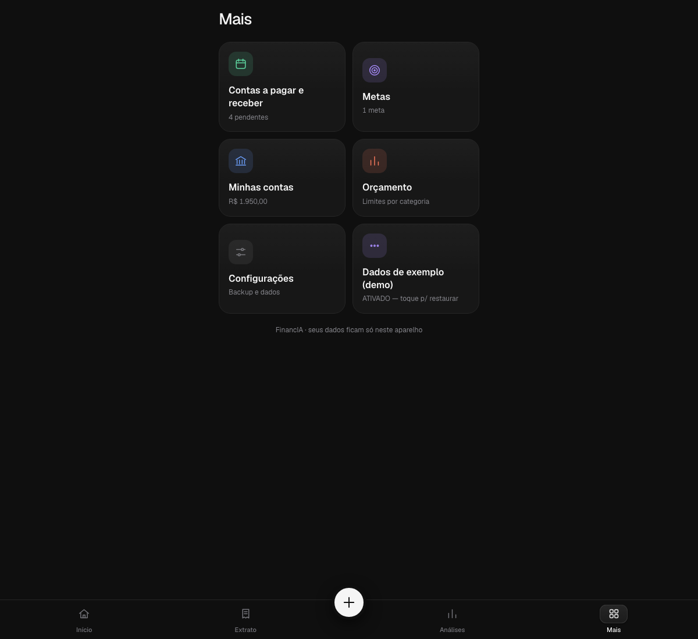

# FinancIA

Controle financeiro pessoal com consultor de IA — local-first, PWA, zero dependências no front.

[](https://github.com/felipefesg/financia)
[](LICENSE)
[](https://nodejs.org)
[](https://workers.cloudflare.com)
[](SECURITY.md)
[](https://web.dev/progressive-web-apps)

---

## Veja como fica

Telas do app com os dados de exemplo embutidos — nenhum dado real.









---

## O que é

FinancIA é um app de finanças pessoais que roda 100% no seu dispositivo (local-first). Seus dados nunca saem do navegador — só vão para a nuvem se você usar o consultor de IA opcional.

---

## Features

📊 **Lançamentos** — receitas, despesas fixas, esporádicas e parceladas  
💳 **Cartões** — controle de faturas e limites  
🎯 **Metas** — separadas do saldo, com progresso visual  
📅 **Orçamento mensal** — alertas de estouro automáticos  
📈 **Plano 30 dias** — simulação de caixa futuro  
🤖 **Consultor IA** — resumo financeiro via Gemini (opcional, sem nomes, e-mails ou dados bancários)  
🌐 **PWA offline** — instala no celular/desktop, funciona sem internet  
🔒 **Privacidade** — dados ficam só no seu dispositivo (localStorage em JSON claro), sem logs de conteúdo, segredos só em env  

---

## Conecte sua IA

O FinancIA nasce sem uma IA acoplada. O consultor de IA é **opcional** e **configurável**: cada pessoa conecta a **própria API key**.

- **No projeto original (deste autor)** é usada uma API gratuita do Google — a **Gemini API free tier** —, com a key gravada como segredo no ambiente do Worker (nunca no código).
- **Para usar a sua**, basta trocar a URL do worker no `index.html` e configurar o seu próprio worker com a sua key. Veja o guia em [COMO-ATIVAR.md](COMO-ATIVAR.md).

```bash
# 1. Copie o modelo de configuração
cp wrangler.example.toml wrangler.toml

# 2. Cadastre a sua key de IA (Google Gemini, o worker atual usa o formato Gemini)
wrangler secret put GEMINI_API_KEY

# 3. Publique o seu worker
wrangler deploy
```

Depois, em `index.html`, aponte a chamada da IA para a URL do SEU worker:

```javascript
// Exemplo: troque pela URL do seu worker
const apiBase = location.origin.includes('localhost') ? '' : 'https://SEU_WORKER.exemplo.workers.dev';
```

---

## Como rodar

```bash
# Abrir direto no navegador (PWA funcional)
open index.html
```

Estrutura: `index.html`, `worker.js`, `sw.js`, `manifest.webmanifest`, `assets/` (fontes, ícones, CSS).

[Guia completo de ativação (IA)](COMO-ATIVAR.md)

---

## Segurança (diferencial)

- **Rate-limit fail-closed**: a rota `/gemini` bloqueia requisições se `RATE_LIMITER` não estiver configurado
- **Segredos via env**: `GEMINI_API_KEY` fica só no ambiente do Worker, nunca no código
- **Cache por origem**: SW e Worker validam `requestUrl.origin === self.location.origin`
- **Sem logs de conteúdo**: o worker registra IP sem identificador em `/gemini`, mas nunca logs de dados pessoais, conversas ou credenciais
- **Dados locais**: tudo em `localStorage` do seu dispositivo (JSON claro, sem criptografia)

---

## Deploy do Worker (opcional)

O worker expõe apenas `POST /gemini`.

1. Copie `wrangler.example.toml` para `wrangler.toml`.
2. Configure o binding `RATE_LIMITER` no painel da Cloudflare ou no `wrangler.toml`.
3. Cadastre o segredo da IA:

```bash
wrangler secret put GEMINI_API_KEY
```

4. Publique:

```bash
wrangler deploy
```

O `index.html` vem com `IA_API` vazio e mostra o aviso "Conecte sua IA". Defina a URL do seu worker nessa constante para ativar o consultor. Exemplo: `https://SEU_WORKER.exemplo.workers.dev`.

---

MIT — Feito com ❤️ para criadores e devs